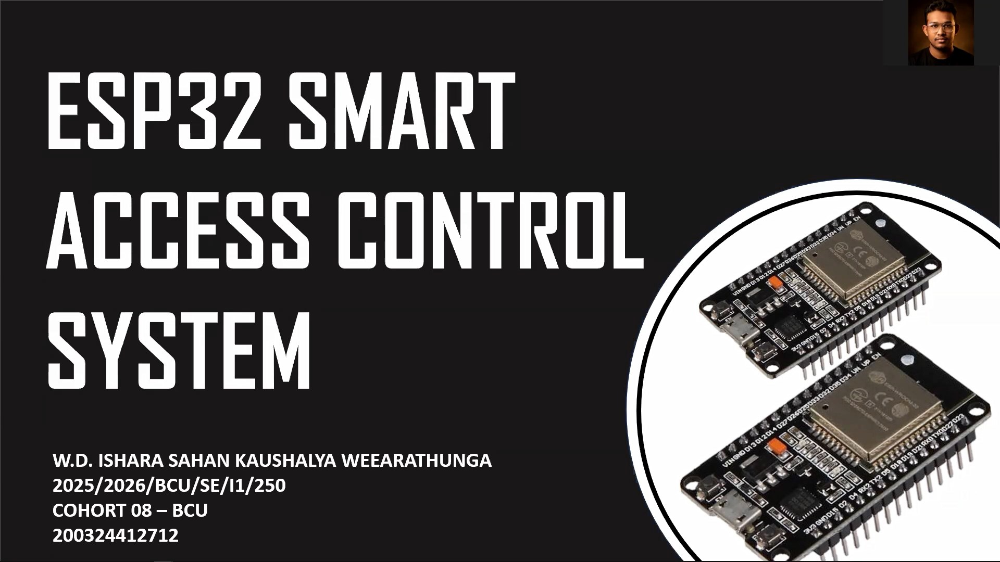
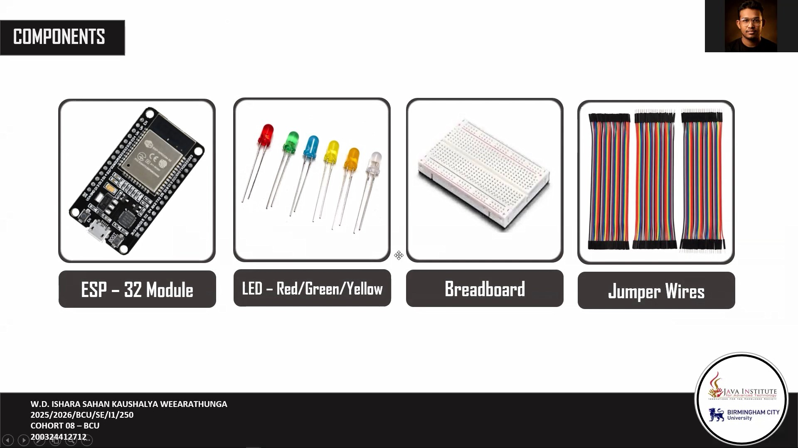
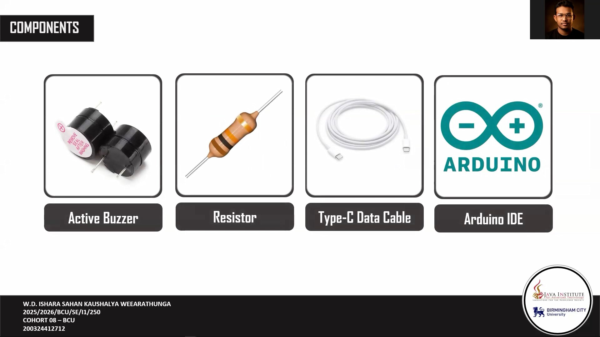
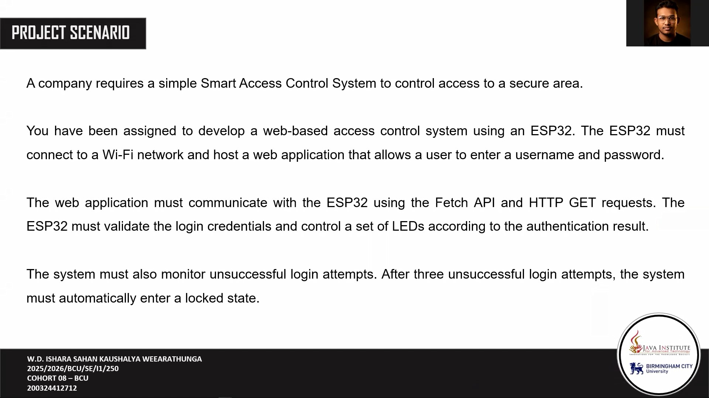
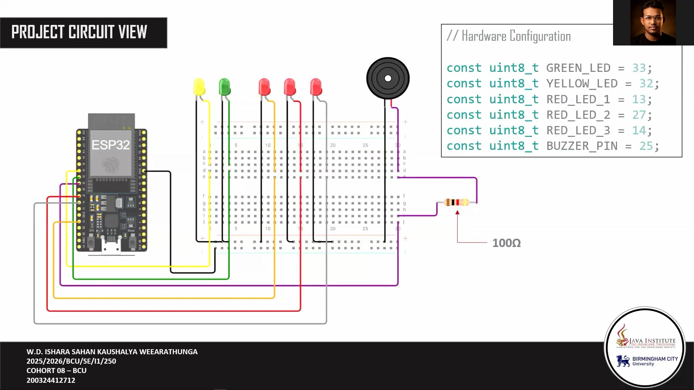
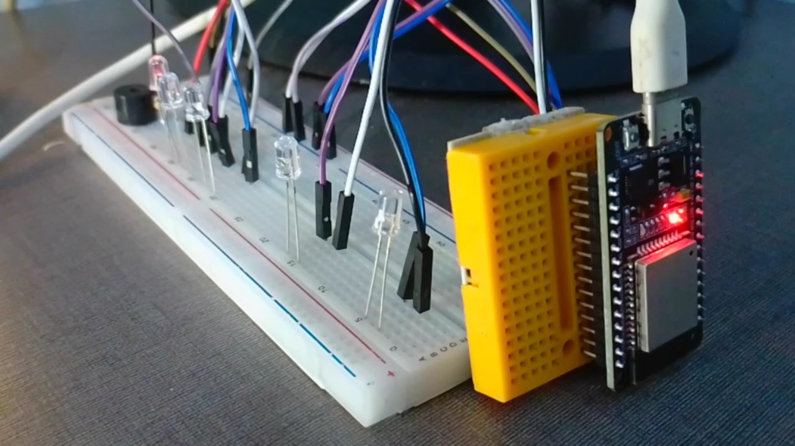
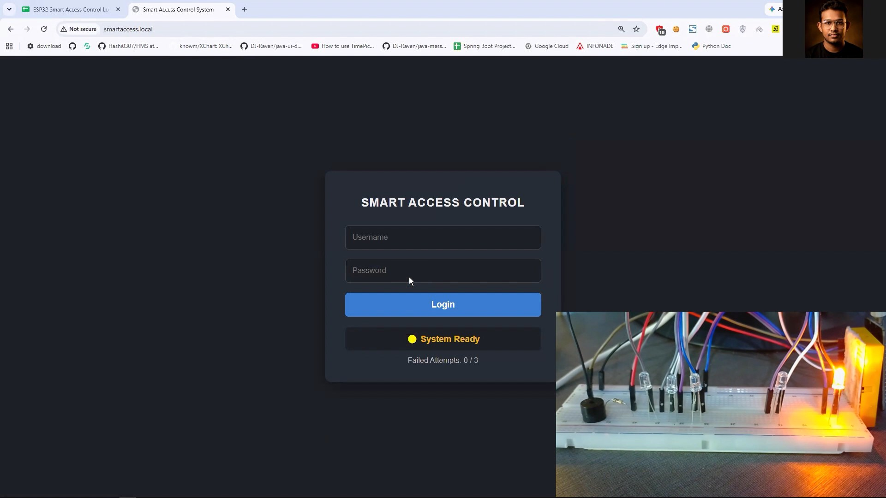
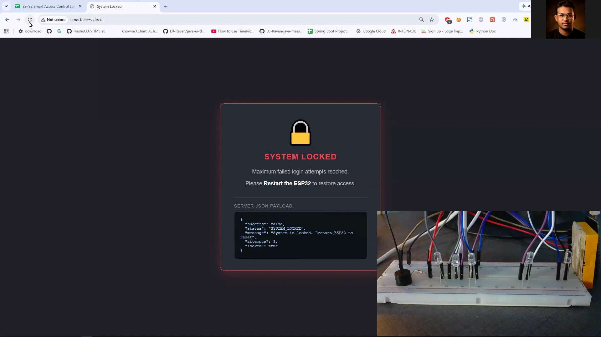
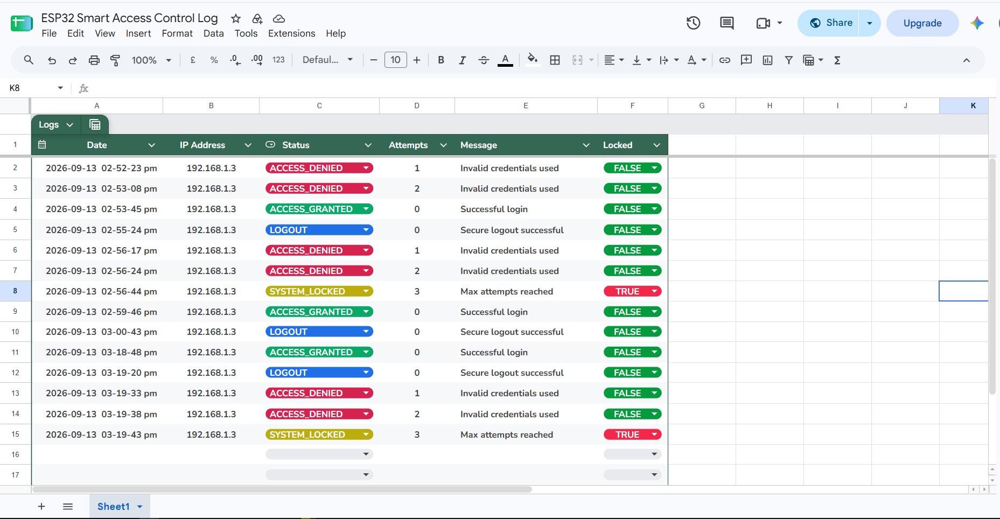

# ESP32 Smart Access Control System

A Wi-Fi-enabled access control system built with an ESP32. The ESP32 hosts a browser-based login interface, validates credentials, provides LED and buzzer feedback, locks after three failed attempts, and sends activity logs to Google Sheets through a Google Apps Script web endpoint.



## Features

- ESP32 web server on port `80`
- mDNS access through `http://smartaccess.local`
- Browser login using the Fetch API and HTTP GET requests
- JSON responses for login and lock status
- Green, yellow, and red LED status indicators
- Buzzer feedback for successful, failed, and locked states
- Lockout after three consecutive failed login attempts
- Google Sheets logging through an HTTPS Google Apps Script endpoint
- Logout and reset of the failed-attempt counter when the system is not locked

## Hardware

| Component | ESP32 GPIO | Purpose |
| --- | ---: | --- |
| Green LED | 33 | Successful login |
| Yellow LED | 32 | Ready and Wi-Fi connection status |
| Red LED 1 | 13 | First failed attempt |
| Red LED 2 | 27 | Second failed attempt |
| Red LED 3 | 14 | Locked state / third failed attempt |
| Buzzer | 25 | Audio status feedback |

Connect each LED through an appropriate current-limiting resistor. Connect the LED and buzzer grounds to ESP32 GND.




## Wiring and System Overview





The device follows this flow:

1. The ESP32 connects to the configured Wi-Fi network.
2. The yellow LED indicates that the system is ready.
3. A browser opens the ESP32 address or `smartaccess.local`.
4. The user submits a username and password.
5. The ESP32 returns a JSON result and updates the LEDs and buzzer.
6. Each event is sent to the configured Google Sheets logger.
7. After three failed attempts, the system enters a locked state and must be restarted.



## Requirements

- ESP32 board and USB cable
- Arduino IDE with ESP32 board support installed
- A 2.4 GHz Wi-Fi network
- LEDs, resistors, and a buzzer
- Optional: Google Apps Script web app connected to Google Sheets for logging

The sketch uses the following ESP32 libraries:

- `WiFi.h`
- `HTTPClient.h`
- `WiFiClientSecure.h`
- `ESPmDNS.h`

These libraries are included with the ESP32 Arduino core.

## Configuration

Open `ESP32_Smart_Access_Control_System.ino` and replace the placeholder values near the top of the file:

```cpp
const char* SSID = "your-wifi-name";
const char* WIFI_PASSWORD = "your-wifi-password";
const char* LOGS_URL = "your-google-apps-script-web-app-url";
```

You can also change the login credentials:

```cpp
const char* VALID_USERNAME = "admin";
const char* VALID_PASSWORD = "1234";
```

Do not publish real Wi-Fi passwords, passwords, or private logging URLs in a public repository. For a production system, move credentials out of the source code and use stronger authentication.

## Upload and Run

1. Install the ESP32 board package in Arduino IDE.
2. Open `ESP32_Smart_Access_Control_System.ino`.
3. Select the correct ESP32 board and serial port.
4. Update the Wi-Fi, logging URL, and login configuration.
5. Upload the sketch to the ESP32.
6. Open Serial Monitor at `115200` baud.
7. Copy the printed IP address, or browse to `http://smartaccess.local` when mDNS is available.
8. Test a valid login, invalid login attempts, logout, and the three-attempt lockout.

The default credentials in the sketch are:

- Username: `admin`
- Password: `1234`

## HTTP Endpoints

### `GET /`

Displays the login page, or the locked page when the system is locked.

### `GET /login?username=<user>&password=<password>`

Validates the supplied credentials and returns JSON similar to:

```json
{
  "success": true,
  "status": "ACCESS_GRANTED",
  "message": "Access Granted",
  "attempts": 0,
  "locked": false
}
```

Possible statuses include `ACCESS_GRANTED`, `ACCESS_DENIED`, and `SYSTEM_LOCKED`.



### `GET /logout`

Resets the failed-attempt counter and redirects the browser to `/`. Logout is unavailable while the system is locked.

## Status Behavior

| Condition | LEDs | Buzzer |
| --- | --- | --- |
| Wi-Fi connecting | Yellow blinks | Off |
| Ready | Yellow on | Off |
| Access granted | Green on | Two short tones |
| First failed attempt | Red 1 on | One long tone |
| Second failed attempt | Red 1 and Red 2 on | One long tone |
| Locked | All red LEDs blink | Repeating tone |



## Google Sheets Logging

The sketch sends URL query parameters to `LOGS_URL` after login and logout events:

- `ip`
- `status`
- `attempts`
- `message`
- `locked`

The supplied log screenshot shows recorded `ACCESS_DENIED`, `ACCESS_GRANTED`, `LOGOUT`, and `SYSTEM_LOCKED` events.



## Project Structure

```text
ESP32_Smart_Access_Control_System/
|-- ESP32_Smart_Access_Control_System.ino
|-- README.md
`-- SS/
    |-- ss.png
    `-- project screenshots
```

## Notes

- A locked system remains locked until the ESP32 restarts.
- The HTTPS logger currently uses `secureClient.setInsecure()`, which skips certificate verification. This is convenient for a prototype but should be replaced with certificate validation for production use.
- The login query uses URL encoding in the browser and URL decoding on the ESP32.
